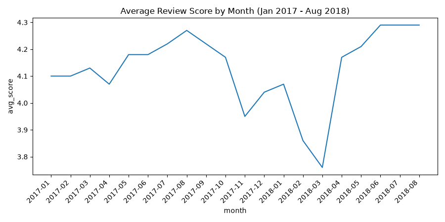

# AI SQL Analyst

Ask questions about a database in plain English and get SQL-backed answers and charts.
Built with LangGraph, Claude Sonnet 5.5 and PostgreSQL, with a Streamlit chat UI.




## What it does

- Turns a natural-language question into SQL, runs it, and explains the result
- Retries automatically when a query fails, because errors go back to the model as text
- Remembers the conversation, so follow-ups like "now only for 2018" work
- Draws line and bar charts on request
- Streams answers as they are generated

Dataset: the public [Olist Brazilian E-commerce dataset](https://www.kaggle.com/datasets/olistbr/brazilian-ecommerce)
(about 100k orders, 9 tables).

## How it works

```
User -> Streamlit UI -> LangGraph agent <-> LLM
                             |
                  tools: get_schema, run_sql, make_chart
                             |
                 PostgreSQL (read-only user)
```

The graph is a loop: the model decides whether to call a tool, the tool runs, and the result
goes back to the model until it can answer. Conversation state is saved per `thread_id`
with a LangGraph checkpointer.

## Safety

1. **Read-only database user.** The agent connects as `agent_ro`, which has SELECT only,
   `default_transaction_read_only = on`, and a 10-second statement timeout.
2. **SQL validation.** Only a single SELECT/WITH statement is allowed; DROP, DELETE, UPDATE
   and similar keywords are rejected before reaching the database.
3. **Row cap.** Results sent back to the model are limited to 50 rows.

## Evaluation

`eval_set.py` runs 14 questions against the agent, each with a hand-written SQL query that
produces the correct answer, and checks that the expected value appears in the agent's reply.
**Current score: 14/14.** Failures during development exposed real definition problems
(for example, whether canceled orders count), which were fixed in `schema_notes.md`.

## Setup

Requires Python 3.11+, Docker, and an Anthropic API key.

```bash
git clone https://github.com/<your-username>/ai-sql-analyst.git
cd ai-sql-analyst
python -m venv .venv
.venv\Scripts\activate          # Windows
pip install -r requirements.txt
```

**1. Start PostgreSQL**

```bash
docker run -d --name sqlagent-db -e POSTGRES_PASSWORD=admin -p 5432:5432 -v sqlagent-data:/var/lib/postgresql/data postgres:16
docker exec -it sqlagent-db psql -U postgres -c "CREATE DATABASE olist;"
```

**2. Load the data.** Download the CSVs from Kaggle into a `data/` folder, then:

```bash
python load_data.py
```

**3. Create the read-only user**

```bash
docker exec -it sqlagent-db psql -U postgres -d olist
```

```sql
CREATE ROLE agent_ro LOGIN PASSWORD 'agent_pw';
GRANT CONNECT ON DATABASE olist TO agent_ro;
GRANT USAGE ON SCHEMA public TO agent_ro;
GRANT SELECT ON ALL TABLES IN SCHEMA public TO agent_ro;
ALTER ROLE agent_ro SET default_transaction_read_only = on;
ALTER ROLE agent_ro SET statement_timeout = '10s';
```

**4. Configure.** Copy `.env.example` to `.env` and add your API key.

**5. Run**

```bash
streamlit run app.py        # web UI
python agent.py             # terminal chat
python eval_set.py          # run the eval set
```

## Project structure

| File | Purpose |
|---|---|
| `agent.py` | LangGraph agent (state, nodes, conditional edges, checkpointing) |
| `agent_tools.py` | `get_schema`, `run_sql`, `make_chart` tools and SQL validation |
| `app.py` | Streamlit chat UI |
| `schema_notes.md` | Table descriptions and business rules given to the model |
| `eval_set.py` | Evaluation questions with expected answers |
| `load_data.py` | Loads the Olist CSVs into PostgreSQL |

## Possible next steps

- Persistent conversations with a Postgres checkpointer
- Retrieval over larger schemas
- A stricter SQL parser instead of keyword checks